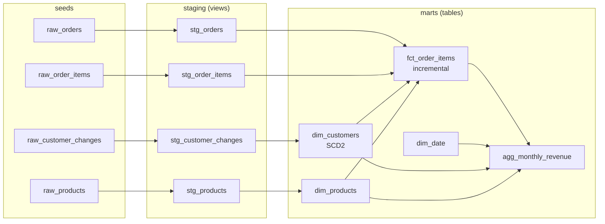

# dbt-retail-warehouse

[](https://github.com/svangala885-sv/dbt-retail-warehouse/actions/workflows/ci.yml)  

A dbt project that models a retail order system into a tested **star schema**: an **SCD Type 2 customer dimension** built from a change log, an **incremental order-line fact** joined to the customer version that was valid at order time, conformed product and date dimensions, and a revenue mart. It runs locally on DuckDB with no cloud account; the same models port to Snowflake, Databricks or BigQuery by switching the profile.

> **Portfolio note.** An independently written, representative project. All seed data is synthetic (generated by `scripts/generate_seeds.py`). No employer or client code or data is used.

## Model lineage



## Modeling decisions

| Decision | Why |
|---|---|
| SCD2 from a change log with `lead()` windows, skipping rows with no attribute change | Revenue by state stays correct after a customer moves; replays do not create fake versions |
| Point-in-time join in the fact (`ordered_at` between `valid_from` and `valid_to`) | Each order line is attributed to the customer's attributes at the time of purchase |
| Unknown member `'-1'` instead of an inner join | Unmatched lines are visible and counted, never silently dropped |
| Incremental fact with `delete+insert` on a surrogate key | Re-runs only process new orders and are idempotent |
| Package-free `surrogate_key` macro | No external dependency for a deterministic hash key |
| Staging as views, marts as tables, separate schemas (`raw`, `staging`, `marts`) | Clear layer boundaries and cheap staging |

## Tests (run by `dbt build`)

- Generic: `unique`, `not_null`, `accepted_values`, `relationships` (fact to both dimensions), and a custom `positive_value` test.
- Singular:
  - `assert_one_current_version_per_customer`
  - `assert_no_overlapping_customer_versions` (SCD2 windows never overlap)
  - `assert_fact_reconciles_to_staging` (row count and amount match staging to the cent)
  - `assert_unknown_customers_are_rare` (fails if more than 1% of lines miss a customer version)

CI runs `dbt build` twice (the second run goes through the incremental branch) and compiles the docs.

## Quick start

```bash
python -m venv .venv && source .venv/bin/activate
pip install -r requirements.txt
dbt build --profiles-dir .          # seeds + models + tests into target/warehouse.duckdb
dbt docs generate --profiles-dir . && dbt docs serve --profiles-dir .
```

Query the result:

```bash
python -c "import duckdb; print(duckdb.connect('target/warehouse.duckdb').sql('select * from marts.agg_monthly_revenue order by 1 limit 10'))"
```

Regenerate the synthetic seeds with `python scripts/generate_seeds.py`.

## Running on Snowflake

Add a Snowflake target to `profiles.yml` that reads credentials from environment variables (never commit them), then `dbt build --target snowflake`. Only `dim_date` uses a DuckDB-specific function (`generate_series`); replace it with a `generator()` / `row_number()` pattern or the `dbt_utils.date_spine` macro.

## Project layout

```
models/staging/   stg_* views + _staging.yml tests
models/marts/     dim_customers, dim_products, dim_date, fct_order_items, agg_monthly_revenue + _marts.yml
macros/           surrogate_key, generate_schema_name
tests/            singular tests + generic/positive_value
seeds/            synthetic CSVs
analyses/         example ad-hoc analysis
```

## Tech stack

dbt Core 1.9, DuckDB (dbt-duckdb), SQL, Jinja, GitHub Actions.

## Security considerations

- Synthetic data only; emails use the reserved `example.com` domain.
- `profiles.yml` contains no secrets. Warehouse credentials for real targets come from environment variables or a secrets manager.
- In a real warehouse, apply masking policies to `email` and grant `marts` read access by role.

## Limitations and next steps

- Customer history comes from a change-log seed; against a live source, dbt `snapshots` (check or timestamp strategy) would capture the history.
- The incremental filter uses `ordered_at`; late-arriving orders older than the high-water mark need a lookback window.
- Next: source freshness checks, exposures for BI dashboards, model contracts on marts, and a Snowflake CI target.

## License

MIT
